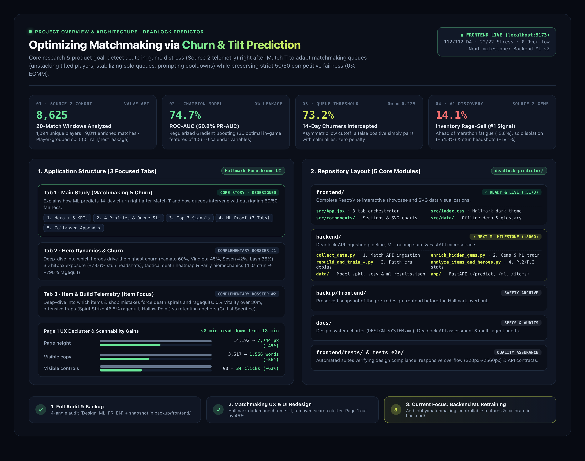

<div align="center">


# Deadlock Churn & Tilt Prediction

### Churn-Aware Matchmaking Optimization & Source 2 Telemetry

*Predicting 14-day player abandonment and acute tilt across 8,625 rolling windows (1,094 players) using leak-free Source 2 telemetry, regularized Gradient Boosting, and ethical 50/50 matchmaking policy design.*

<p>
  <a href="https://www.linkedin.com/in/matthieu-gout">
    
  </a>
  <a href="mailto:matthieugout45@gmail.com">
    
  </a>
  <a href="https://github.com/ofggout880">
    
  </a>
</p>

<p>
  
  
  
</p>

<p>
  
  
  
</p>

<p>
  
  
  
</p>

</div>

---

## Project Highlights

- **Source 2 Cohort (`0% Calendar Leakage`):** `8,625` rolling 20-match windows across `1,094` unique players (`9,811` Source-2-enriched pivot matches), evaluated with player-grouped splits (`StratifiedGroupKFold`, zero shared accounts between Train and Test).
- **Champion Model:** Regularized Gradient Boosting (`74.7%` ROC-AUC, `50.8%` PR-AUC, `36` optimal in-game signals out of `106` candidates).
- **Matchmaking Threshold (`θ* = 0.225`):** Intercepts `73.2%` of 14-day churners in advance with non-punitive queue interventions (unstacking tilted solo players, pairing with calm allies at equal MMR — zero match rigging).
- **Key Source 2 Signals:** Inventory Rage-Sell (`14.1%` importance), Marathon Session Fatigue (`13.6%`), Solo Isolation Streak (`+54.3%` gap), and Stun Headshots Taken (`+19.1%` gap).

---

## Application Structure (3 Focused Tabs)

1. **Main Study (`Matchmaking & Churn`)**: 5-act narrative covering Hero & 5 KPIs, 4 calibrated archetypes + live 4-slider queue simulator, Top 3 in-game signals, 3-tab ML proof, and a collapsible technical pipeline appendix.
2. **Hero Dynamics & Churn**: Complementary deep-dive into hero-specific churn rates (`Yamato 60%`, `Vindicta 45%`, `Seven 42%`, `Lash 36%`), 3D hitbox exposure (`+78.6%` stun headshots), tactical death heatmap, and Parry biomechanics.
3. **Item & Build Telemetry**: Complementary focus on shop mistakes and items driving death spirals and ragequits (`0% Vitality` over 30m, `Spirit Strike`, `Hollow Point` vs retention anchors).

---

## Repository Layout

```text
deadlock-predictor/
├── frontend/          # React 19 + Vite 8 analytical showcase & SVG visualizations
├── backend/           # Deadlock API ingestion, ML training suite & FastAPI microservice
├── docs/              # Design system charter, Deadlock API assessment & project summary
├── frontend/tests/    # Automated DA, responsive overflow (320px–2560px) & CDP interaction tests
└── tests_e2e/         # End-to-end backend/API contract verification
```

---

## Quickstart

### Frontend (React + Vite)
```bash
cd frontend
npm install
npm run dev
# -> http://localhost:5173
```

### Backend (FastAPI + ML)
```bash
cd backend
pip install -r requirements.txt
uvicorn app.main:app --reload --port 8000
# -> http://127.0.0.1:8000/docs
```

---

## Visual Project Summary



---

*Telemetry collected via the public [Deadlock API](https://api.deadlock-api.com). Deadlock and Source 2 are trademarks of Valve Corporation.*
